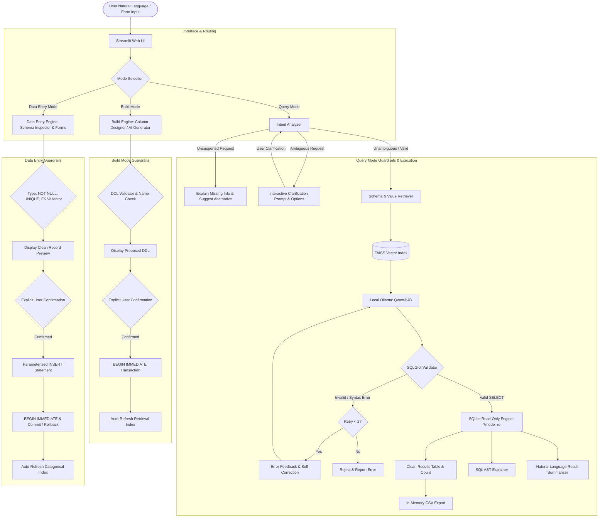

# Talk to Your Database

An intelligent, secure, local-first Natural Language-to-SQL conversational application powered by SQLite, Streamlit, Sentence Transformers, FAISS, SQLGlot, and the local `qwen3:4b` language model running in Ollama.

Unlike basic Text-to-SQL toys that naively pass user input to an LLM, **Talk to Your Database** implements database-aware categorical value profiling, ambiguity detection, unsupported query refusal, SQLGlot AST validation, bounded self-correction, plain-English SQL explanations, factual result summarization, a strictly guarded Build Mode, and a dynamic, type-safe Data Entry Mode.

---

## Table of Contents

- [Problem Statement](#problem-statement)
- [Key Features](#key-features)
  - [1. Query Mode (Read-Only AI Assistant)](#1-query-mode-read-only-ai-assistant)
  - [2. Build Mode (Controlled Table Creation)](#2-build-mode-controlled-table-creation)
  - [3. Data Entry Mode (Transactional Record Insertion)](#3-data-entry-mode-transactional-record-insertion)
  - [4. Live Database Overview & Health Monitoring](#4-live-database-overview--health-monitoring)
- [System Architecture](#system-architecture)
- [Technology Stack](#technology-stack)
- [Security & Database Safety Controls](#security--database-safety-controls)
- [Installation and Setup](#installation-and-setup)
- [Execution & Usage](#execution--usage)
- [Evaluation & Benchmark Results](#evaluation--benchmark-results)
- [Known Limitations](#known-limitations)
- [Project Structure](#project-structure)

---

## Problem Statement

Basic Natural Language-to-SQL interfaces suffer from several critical vulnerabilities and failure modes:
1. **Blind Semantic Assumptions:** When faced with ambiguous questions (e.g., *"Show me the top employees"*), basic systems arbitrarily guess ordering criteria without consulting the user.
2. **Hallucination on Unsupported Queries:** When asked for forecasting or missing attributes (e.g., *"Predict next month's salary"* or *"Find the employee photo"*), naive models hallucinate non-existent columns and generate fake SQL.
3. **Database Terminology Mismatch:** Natural language rarely matches internal database identifiers (e.g. asking for *"technical department"* when the database stores `'Engineering'`).
4. **Execution Insecurity:** Unvalidated LLM-generated SQL risks executing data-modifying commands (DML/DDL), multiple semicolon-delimited statements, or unsafe queries.
5. **Opaque Results:** Users without SQL knowledge cannot verify whether the generated query actually answers their question, and raw tabular output provides no natural-language interpretation.

**Talk to Your Database** solves these challenges through guarded architectural boundaries, structured intent analysis, categorical value retrieval, deterministic AST validation, and strict separation between Query Mode, Build Mode, and Data Entry Mode.

---

## Key Features

### 1. Query Mode (Read-Only AI Assistant)

- **Database-Aware Categorical Value Profiling & Retrieval:**
  - Extracts safe, low-cardinality textual categorical values from SQLite tables (e.g., departments: `'Engineering'`, `'HR'`, `'Sales'`).
  - Preserves privacy: excludes personal tokens (`name`, `email`, `phone`, `address`) and free-text fields (`notes`, `description`).
  - Embeds categorical profiles alongside schema metadata in a FAISS vector index using Sentence Transformers (`all-MiniLM-L6-v2`).
  - Maps alternative and domain terminology (e.g. *"technical department"* or *"tech team"*) to exact database values (`'Engineering'`).

- **Ambiguity Detection & Interactive Clarification:**
  - Actively identifies questions with multiple plausible interpretations (e.g., *"Show me the top employees"*, *"Show recent orders"*, *"Which is the best department?"*).
  - Halts execution **before** generating SQL, displaying concise clarification questions and interactive option buttons.
  - Seamlessly combines user clarification with the original question to produce an unambiguous prompt before query execution.

- **Unsupported Query Detection & Helpful Guidance:**
  - Identifies requests that cannot be answered with the available schema or supported operations (e.g. predictive forecasting, image files, missing tables, prohibited DML).
  - Explains exactly why the query cannot be answered and identifies the missing database information.
  - Proactively suggests valid alternative queries the database *can* answer.

- **Bounded Self-Correction Loop:**
  - Captures SQL syntax errors, unknown column names, and SQLite execution failures.
  - Feeds exact error feedback back to `qwen3:4b` to generate a targeted correction.
  - Strictly bounded to a maximum of 2 correction attempts (3 total attempts).
  - Every correction attempt must pass SQLGlot validation before reaching the database.

- **Plain-English SQL Explanation:**
  - Analyzes the generated query using SQLGlot AST inspection to produce a factual, beginner-friendly explanation.
  - Explains tables queried, columns retrieved, WHERE filters, GROUP BY grouping, ORDER BY directions, and LIMIT counts without hallucinating operations.

- **Natural-Language Result Interpretation:**
  - Summarizes returned database rows in plain English (e.g. *"Found 2 employees in Engineering: Anu ($45,000) and Meera ($52,000)"*).
  - Handles empty result sets gracefully without hallucinating records.
  - Handles large result sets concisely by reporting total counts and representative samples.
  - Strictly read-only and never modifies data.

- **Safe CSV Export:**
  - Generates downloadable CSV representations in memory with exact column headers and values.

---

### 2. Build Mode (Controlled Table Creation)

- **Dual Creation Methods:**
  - **Manual Column Designer:** Design tables interactively by specifying table name and individual column properties (column name, data type, Primary Key, Auto-increment, Not Null, Unique, and Default Value).
  - **Natural-Language AI Proposal:** Describe desired tables in plain English; local `qwen3:4b` proposes a compliant SQLite `CREATE TABLE` statement.
- **Strict DDL Validation:**
  - Rejects multiple statements, `DROP`, `ALTER`, `CREATE VIRTUAL TABLE`, `CREATE TABLE AS SELECT`, or non-CREATE statements.
  - Enforces valid SQLite identifiers and checks against existing tables to prevent accidental overwrites.
- **Explicit Confirmation & Immediate Transactions:**
  - Displays proposed DDL syntax-highlighted for human review.
  - Requires explicit checkbox confirmation before execution.
  - Executes table creation inside `BEGIN IMMEDIATE` transactions.
- **Automatic Schema & Index Refresh:**
  - Automatically clears cached retriever indexes and regenerates schema and categorical documents so newly created tables are immediately queryable.

---

### 3. Data Entry Mode (Transactional Record Insertion)

- **Dynamic Schema Inspection:**
  - Uses SQLite `PRAGMA table_info`, `PRAGMA foreign_key_list`, and `PRAGMA index_list` to automatically construct input forms matching existing tables.
- **Type-Aware Form Controls:**
  - `INTEGER` → Integer number input (with auto-increment detection).
  - `REAL` → Decimal/numeric input.
  - `BOOLEAN` → Form checkbox.
  - `TEXT` → Text inputs.
  - `FOREIGN KEY` → Live dropdown selectbox populated with existing referenced keys from the parent table.
- **Multi-Level Constraint Validation:**
  - Validates `NOT NULL` constraints and applies table `DEFAULT` values when empty.
  - Enforces type conversions and flags invalid strings for numeric fields.
  - Pre-checks `UNIQUE` constraints to detect duplicate entries before database calls.
  - Validates foreign key relationships against existing parent table rows.
- **Two-Stage Record Preview & Explicit Confirmation:**
  - Displays a clean key-value preview of the validated record before writing to the database.
  - Requires explicit user checkbox confirmation before executing the insert.
- **Safe Transactional Insertion:**
  - Uses strictly parameterized queries (`INSERT INTO table (...) VALUES (?, ...)`).
  - Never concatenates user input into SQL strings.
  - Wraps execution in `BEGIN IMMEDIATE` transactions with automatic rollback on error.
  - Displays the inserted record and live recent records for visual verification.
  - Automatically refreshes retrieval indexes so newly inserted categorical values are immediately recognized in Query Mode.

---

### 4. Live Database Overview & Health Monitoring

- **Live Ollama Health Probe:**
  - Actively probes `http://localhost:11434/api/tags` to verify server connectivity and model availability without false claims.
- **Database Overview Panel:**
  - Displays active database filename, total tables count, and per-table row counts.
  - Shows complete column definitions and data types directly from SQLite metadata.
- **Manual Schema Refresh:**
  - Sidebar button to instantly reload FAISS indexes and categorical value documents on demand.

---

## System Architecture



---

## Technology Stack

- **Language:** Python 3.10+ (tested on Python 3.14)
- **User Interface:** Streamlit
- **Database Engine:** SQLite (with URI read-only connection mode `?mode=ro` in Query Mode, transactional immediate writes in Build/Data Entry Mode)
- **Local LLM Runtime:** Ollama
- **Primary LLM:** `qwen3:4b`
- **Embedding Model:** `sentence-transformers/all-MiniLM-L6-v2`
- **Vector Search Index:** FAISS (`IndexFlatIP`, inner product on normalized embeddings)
- **SQL Parser & Validator:** SQLGlot (`dialect="sqlite"`)
- **Testing & Benchmarking:** Python `unittest`, CSV/JSON reporting

---

## Security & Database Safety Controls

1. **Read-Only Connection Mode:** Query Mode connects to SQLite using `file:sample.db?mode=ro`, cryptographically preventing write access at the OS/database engine level.
2. **SQLGlot AST Parsing:** Every generated query is parsed into an abstract syntax tree (AST). Any non-`Query` expression or non-SELECT statement is immediately rejected.
3. **Prohibited Operation Blacklist:** Commands including `INSERT`, `UPDATE`, `DELETE`, `DROP`, `ALTER`, `CREATE`, `ATTACH`, `DETACH`, `PRAGMA`, and `VACUUM` are strictly blocked in Query Mode.
4. **Single Statement Enforcement:** Rejects multiple semicolon-delimited queries to prevent SQL injection stacking.
5. **Query Progress Handler & Timeout:** SQLite progress handlers limit CPU execution opcodes to 100,000 steps to prevent denial-of-service / runaway Cartesian products.
6. **Result Row Limiting:** Query results are capped at 200 rows to prevent memory exhaustion.
7. **Guarded Build Mode:** Table creation requires proposal generation, structure validation, duplicate name checks, and explicit user checkbox confirmation before transactional execution (`BEGIN IMMEDIATE`).
8. **Parameterized Data Entry:** Data Entry Mode strictly uses parameterized queries (`?` placeholders). SQL injection payloads are safely stored as literal strings without altering statement structure.
9. **Atomic Commit and Rollback:** All write operations execute inside immediate transactions and roll back cleanly upon encountering SQLite constraint errors.

---

## Installation and Setup

### 1. Prerequisites
- Python 3.10 or higher.
- [Ollama](https://ollama.com/) installed and running locally.
- Pull the required model:
  ```powershell
  ollama pull qwen3:4b
  ```

### 2. Environment Setup
Clone the repository and set up the virtual environment:

```powershell
git clone <repo-url>
cd "Talk To Your DB"
python -m venv .venv
.\.venv\Scripts\Activate.ps1
python -m pip install -r requirements.txt
```

### 3. Initialize Sample Database
Create the sample SQLite database containing sample tables (`employees`, `products`, `customers`, `invoices`, etc.):

```powershell
python .\create_sample_db.py
```

### 4. Run Automated Tests
Execute the complete regression, security, generalization, and unit test suite (74 tests with zero resource warnings):

```powershell
.\.venv\Scripts\python.exe -W error::ResourceWarning -m unittest test_suite_all.py test_security_audit.py test_second_db_generalization.py test_app_regression.py test_data_entry.py test_query_engine_features.py test_value_profiler.py test_sql_safety.py
```

### 5. Run Performance & Latency Benchmark
Run the cold-start and warm-run latency benchmark across 5 query archetypes:

```powershell
.\.venv\Scripts\python.exe benchmark_performance.py
```

---

## Execution & Usage

Start the Streamlit application:

```powershell
.\.venv\Scripts\streamlit.exe run .\app.py
```
*(Alternatively, with virtual environment activated: `streamlit run app.py`)*

Open the local browser interface at `http://localhost:8501`.

### Query Mode
1. Type a question in plain English or select one of the suggested sample questions.
2. If ambiguous, select your desired interpretation from the clarification buttons.
3. View retrieved schema similarity scores, validated SQL, explanation, result table, and natural-language summary.
4. Download returned records as CSV if needed.

### Build Mode
1. Switch to **🛠️ Build Mode** in the sidebar.
2. Choose either **Manual Column Designer** or **Natural-Language AI Proposal**.
3. Configure columns or describe your desired table.
4. Review the validated `CREATE TABLE` statement.
5. Check the explicit confirmation box and click **Create Table**.
6. Schema documents and vector indexes are automatically refreshed.

### Data Entry Mode
1. Switch to **📝 Data Entry Mode** in the sidebar.
2. Select an existing table from the dropdown.
3. Fill out the dynamically generated form fields.
4. Click **Preview Record for Insertion** to validate against SQLite constraints.
5. Review the record preview, check the confirmation box, and click **Confirm & Insert Record**.
6. The record is inserted via parameterized SQL, and the search index is updated.

---

## Evaluation & Benchmark Results

### 1. Original 30-Question Benchmark (Preserved)

Evaluated under strict expected-result shape matching:

| Configuration | Question Count | Correct | Accuracy |
|---|:---:|:---:|:---:|
| **Baseline** (No RAG, No Self-Correction) | 30 | 22 | 73.3% |
| **Schema RAG** (RAG On, No Self-Correction) | 30 | 22 | 73.3% |
| **Full System** (RAG On, Self-Correction On) | 30 | 23 | 76.7% |

*Note: In the original benchmark, 7 failures were due to column selection differences (e.g., selecting all columns `*` instead of `name, salary`) rather than record filtering errors.*

### 2. Expanded 47-Question Benchmark

An expanded benchmark was created in `evaluation_dataset_expanded.csv` covering:
- Simple SELECT projections
- Numerical and text filters
- Sorting and deterministic limits
- Aggregations and GROUP BY / HAVING
- Alternative terminology and categorical value matching
- Ambiguity detection & clarification resolution
- Unsupported query detection (predictions, multimedia, out-of-scope fields, prohibited DML)
- Empty database tables

Summary Results:
- **Execution Accuracy:** 95.74% (45 / 47 correct)
- **Unsupported Detection Rate:** 100% (8 / 8 out-of-scope questions rejected with guidance)
- **Ambiguity Detection Rate:** 75% (3 / 4 ambiguous questions intercepted for clarification)
- **SQL Validity Rate:** 74.47% (35 / 47 queries valid SELECT SQL; remaining 12 safely refused or intercepted)
- **Strict Exact-Shape Accuracy:** 70.21% (33 / 47 exact column matches; non-matches caused by projection variations like `*` vs `name, salary`)

### 3. Cross-Database Generalization Benchmark (`retail.db`)

To ensure the system is not overfitted to `sample.db`, a second independent database (`retail.db`) with 5 tables (`customers`, `products`, `orders`, `order_items`, `promotions`) was dynamically indexed and tested across 13 distinct functional scenarios:
- **Scenarios Tested:** Non-employee schema inspection, customer retrieval, city filtering & categorical profiling, total sales aggregation, sales by customer join, highest-selling product join, multi-table orders join, low-stock filtering, multi-condition filtering, zero-row table querying, retail ambiguity detection, retail unsupported query detection, and dynamic FAISS index generation.
- **Result:** **100% Pass Rate (13 / 13 scenarios passed)** with zero warnings.

### 4. Performance & Latency Profile (`benchmark_performance.py`)

Benchmarked against local `qwen3:4b` in the active environment:
- **Cold Start:** Total response 16.40s (FAISS index build: 1.24s, generation: 15.14s, execution: 26.65ms).
- **Warm Runs (Average):** Total response 27.98s (vector retrieval: 28.98ms, generation: 27.95s, execution: 5.39ms).
- **Memory Footprint:** Peak traced memory: 98.17 MB.

Detailed comparative analysis, confusion matrices, and failure breakdowns are documented in [`EVALUATION_ANALYSIS.md`](file:///d:/Talk%20To%20Your%20DB/EVALUATION_ANALYSIS.md).

---

## Known Limitations

1. **Local Model Capacity:** `qwen3:4b` is a 4-billion parameter local model. While fast and private, complex multi-table joins or nested correlated subqueries can occasionally exceed its reasoning capabilities compared to 70B+ models.
2. **Column Projection Variation:** The LLM may project all columns (`SELECT *`) when natural-language queries do not explicitly specify output columns (e.g., *"Find employees with salary above 40000"*).
3. **Single Database Engine:** SQLite is the only supported dialect; remote PostgreSQL and MySQL connections are out of scope.
4. **Scope-Separated Modifications:** Query Mode strictly prohibits data modification; insertions must occur via Data Entry Mode and table creation via Build Mode.

---

## Project Structure

```text
Talk To Your DB/
├── app.py                         # Streamlit web application & multi-mode interface
├── build_engine.py                # Build Mode: column designer, AI proposal, & safe table creation
├── data_entry_engine.py           # Data Entry Mode: schema metadata, form validation, & parameterized INSERT
├── query_engine.py                # Query Mode: query engine, ambiguity & intent analysis, explanation, summarization
├── schema_inspector.py            # SQLite schema introspection & PRAGMA analysis
├── schema_documents.py            # Schema document & metadata generation
├── schema_retriever.py            # SentenceTransformers + FAISS vector retriever
├── value_profiler.py              # Categorical value profiling & privacy filters
├── create_sample_db.py            # Sample database generator (sample.db)
├── benchmark_performance.py       # Performance & latency benchmark tool
├── performance_benchmark_results.json # Repeatable latency & memory benchmark results
├── evaluate.py                    # Original 30-question evaluation runner
├── evaluate_expanded.py           # Expanded 47-question comprehensive evaluation runner
├── evaluation_dataset.csv         # Original 30-question benchmark dataset
├── evaluation_dataset_expanded.csv# Expanded 47-question evaluation dataset
├── test_app_regression.py         # End-to-end multi-mode application regression test suite
├── test_security_audit.py         # Security regression test suite (SELECT INTO, CTE DML, multi-statement, etc.)
├── test_second_db_generalization.py # Cross-database generalization test suite (retail.db)
├── test_suite_all.py              # Consolidated integration test suite
├── test_data_entry.py             # Unit & integration tests for Data Entry Mode and Build Mode
├── test_query_engine_features.py  # Unit tests for query engine components
├── test_value_profiler.py         # Unit tests for categorical value profiler
├── test_sql_safety.py             # Unit tests for SQL validation rules
├── DEMO_SCRIPT.md                 # Live demonstration walk-through script
├── EVALUATION_ANALYSIS.md         # Comprehensive evaluation, generalization, & latency report
├── requirements.txt               # Python package dependencies
└── README.md                      # Project documentation
```
